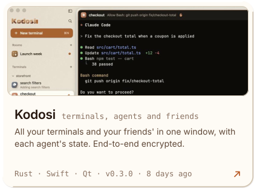
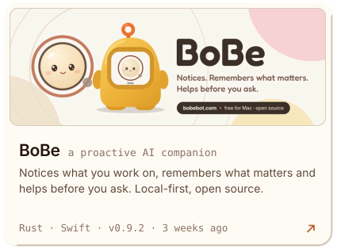
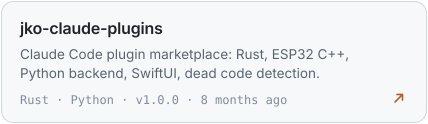
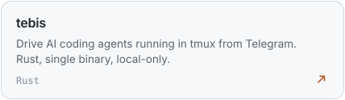
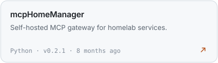
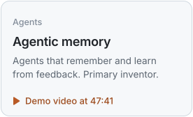
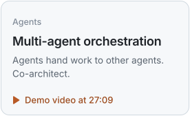
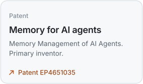

<a href="https://www.linkedin.com/in/john-kozaris/#gh-dark-mode-only"><picture><source media="(max-width: 600px)" srcset="assets/hero-narrow-dark.svg"></picture></a>
<a href="https://www.linkedin.com/in/john-kozaris/#gh-light-mode-only"><picture><source media="(max-width: 600px)" srcset="assets/hero-narrow-light.svg"></picture></a>

<h3 align="center">Open source</h3>

<a href="https://github.com/johnkozaris/Kodosi"><picture><source media="(prefers-color-scheme: dark)" srcset="assets/project-kodosi-dark.svg"></picture></a>
<a href="https://github.com/Sombrace/BoBe"><picture><source media="(prefers-color-scheme: dark)" srcset="assets/project-bobe-dark.svg"></picture></a>

<a href="https://github.com/johnkozaris/web-interact"><picture><source media="(prefers-color-scheme: dark)" srcset="assets/repo-web-interact-dark.svg"></picture></a>
<a href="https://github.com/johnkozaris/jko-claude-plugins"><picture><source media="(prefers-color-scheme: dark)" srcset="assets/repo-plugins-dark.svg"></picture></a>
<a href="https://github.com/johnkozaris/tebis"><picture><source media="(prefers-color-scheme: dark)" srcset="assets/repo-tebis-dark.svg"></picture></a>
<a href="https://github.com/johnkozaris/mcpHomeManager"><picture><source media="(prefers-color-scheme: dark)" srcset="assets/repo-home-dark.svg"></picture></a>

<h3 align="center">At Microsoft</h3>

<a href="https://youtu.be/8OviTSFqucI?t=2861"><picture><source media="(prefers-color-scheme: dark)" srcset="assets/proof-memory-dark.svg"></picture></a>
<a href="https://youtu.be/ceV3RsG946s?t=1629"><picture><source media="(prefers-color-scheme: dark)" srcset="assets/proof-orchestration-dark.svg"></picture></a>
<a href="https://patents.google.com/patent/EP4651035A2/en"><picture><source media="(prefers-color-scheme: dark)" srcset="assets/proof-patent-dark.svg"></picture></a>

<a href="https://x.com/kozaris">X</a>&nbsp;&nbsp;&nbsp;&nbsp;<a href="https://www.linkedin.com/in/john-kozaris/">LinkedIn</a>&nbsp;&nbsp;&nbsp;&nbsp;<a href="https://github.com/johnkozaris/johnkozaris/blob/main/HOW-IT-WORKS.md">How this page works</a>

